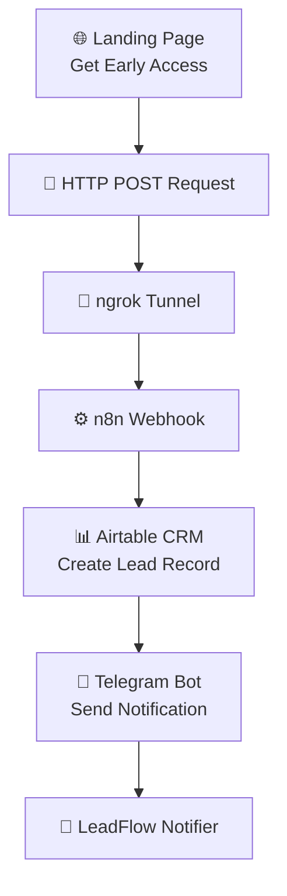

# 🚀 LeadFlow — Automated Lead Capture & CRM Integration

### An end-to-end lead management automation built with n8n, Airtable, Telegram Bot API, and ngrok.


## 📌 Overview

**LeadFlow** is an automated lead capture and notification system designed to streamline the process of collecting and managing early-access registrations.

The project connects a landing page registration form to an Airtable CRM database using an n8n workflow and delivers automated Telegram notifications whenever a new lead is submitted.

It eliminates repetitive manual data entry, centralizes lead information, and helps ensure that incoming registrations receive timely attention.

## ✨ Key Features

- **Automated Lead Capture** — Collects registration details directly from a landing page.
- **Webhook Integration** — Processes incoming HTTP POST requests through n8n.
- **CRM Integration** — Creates lead records automatically in Airtable.
- **Telegram Notifications** — Sends instant alerts through the LeadFlow Notifier bot.
- **Local Development Support** — Uses ngrok to expose a local webhook endpoint.
- **Low-Code Architecture** — Connects multiple services through a visual automation workflow.

## 🏗️ System Architecture



### Workflow Components

| Component | Technology | Responsibility |
|---|---|---|
| Registration Form | Web Form | Collects user information |
| Public Tunnel | ngrok | Exposes the local webhook endpoint |
| Webhook Handler | n8n | Receives incoming POST requests |
| CRM Database | Airtable | Stores lead information |
| Notification Service | Telegram Bot API | Delivers new lead alerts |

## ⚙️ How It Works

**Step 1 — Lead Submission**

A visitor opens the *Get Early Access* landing page and completes the registration form.

The form collects:

- Full Name
- Email Address
- Company (optional)

**Step 2 — Webhook Trigger**

After submission, the form sends an HTTP POST request containing the lead information to the n8n webhook endpoint, exposed through an ngrok tunnel.

**Step 3 — Workflow Execution**

The n8n workflow receives the submitted data and processes the incoming registration.

**Step 4 — CRM Record Creation**

A new lead record is automatically created in the Airtable **CRM Leads** table.

**Step 5 — Telegram Notification**

The workflow sends a message through the **LeadFlow Notifier** Telegram bot, including the submitted contact information and registration timestamp.

**Step 6 — Lead Management**

The registration is stored in the CRM, while the Telegram notification enables prompt follow-up without manually checking the database.

## 🛠️ Tech Stack

| Technology | Purpose |
|---|---|
| n8n | Workflow automation and service integration |
| Airtable | CRM database and lead storage |
| Telegram Bot API | Automated notifications |
| ngrok | Secure tunneling for local development |
| HTTP Webhooks | Event-driven data transmission |
| JSON | Structured data exchange |

## 📡 Example Webhook Payload

The registration form submits data using an HTTP POST request.

```http
POST /webhook/lead-capture
Content-Type: application/json
```

Example JSON payload:

```json
{
  "name": "Jane Doe",
  "email": "jane@example.com",
  "company": "Example Company"
}
```

*Note: The endpoint path and sample data are illustrative. The actual webhook URL is configured in n8n.*

## 📲 Telegram Notification

When a new registration is processed, the Telegram bot sends a notification similar to:

```text
🔔 New Lead Received!

👤 Name: Jane Doe
📧 Email: jane@example.com
🏢 Company: Example Company
📅 Submitted: 2026-09-21 12:06
```

This provides immediate visibility into new registrations.

## 🚀 Getting Started

### Prerequisites

To recreate this automation, you will need:

- An n8n instance
- An Airtable account and CRM base
- A Telegram bot created through BotFather
- An ngrok account and installed ngrok client
- A registration form capable of sending HTTP POST requests

### 1. Configure Airtable

Create an Airtable base with a table named `CRM Leads`.

Configure the relevant lead fields, including Full Name, Email, and Company.

### 2. Configure n8n

Create a workflow containing the following nodes:

1. **Webhook** — Receive registration data.
2. **Airtable: Create a record** — Store the lead.
3. **Telegram: Send a text message** — Notify the recipient.

Connect the nodes in the order shown above.

### 3. Configure ngrok

Start an ngrok tunnel pointing to the port used by your local n8n instance.

For example, if n8n is running on its default port:

```bash
ngrok http 5678
```

Use the generated public HTTPS URL to make the local webhook accessible.

### 4. Connect the Registration Form

Configure the landing page to send form submissions to the appropriate n8n webhook URL.

Map the form inputs to the expected fields:

```text
Full Name → name
Email     → email
Company   → company
```

### 5. Configure Telegram

Create a Telegram bot using BotFather.

Add its credentials to n8n and configure the recipient chat ID in the Telegram node.

### 6. Test the Workflow

Submit a test registration and verify that:

- The webhook receives the request.
- A new Airtable record is created.
- The Telegram bot sends a notification.
- The submitted information matches across the integrations.

Activate the workflow and configure the production webhook URL when ready.

## 📊 Results

The implemented workflow demonstrates successful integration between the registration form, n8n, Airtable, and Telegram.

The project includes evidence of:

- A working n8n automation workflow.
- A completed early-access registration form.
- A successful HTTP request through ngrok.
- A newly created Airtable CRM record.
- Telegram notifications containing lead information.

**Outcome:** A functional automated lead intake pipeline that reduces manual data entry and improves visibility into new registrations.

## 🔐 Security Considerations

When deploying or sharing this project:

- Store API tokens and credentials securely.
- Never commit Telegram bot tokens, Airtable API keys, or other secrets.
- Use HTTPS endpoints for webhook communication.
- Validate and sanitize incoming form data.
- Consider adding rate limiting and spam protection.
- Avoid publishing real lead information or personal contact details.

## 🔮 Future Improvements

Potential enhancements include:

- Email validation and duplicate lead detection.
- Automated confirmation emails.
- Lead qualification and prioritization.
- Error handling and retry mechanisms.
- Analytics dashboards for registration activity.
- Integration with additional CRM platforms.
- Spam prevention and webhook authentication.

## 🎯 Project Purpose

This pet project was developed to gain practical experience with:

- Building event-driven automation workflows.
- Integrating third-party APIs.
- Processing HTTP webhook requests.
- Automating CRM data management.
- Implementing bot-based notifications.
- Connecting multiple services into a single workflow.

## 👩‍💻 Author

**Alina Zinchenko**

*Automation & Integration Enthusiast*

---

⭐ If you find this project interesting, consider giving the repository a star!
